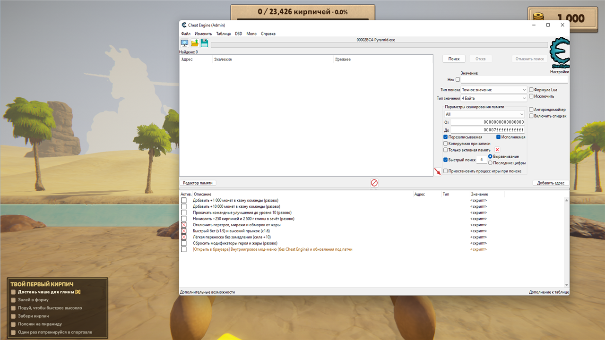

# How They Built the Pyramids - Внутриигровое мод-меню (v1.0)

Мод-меню на русском, готовое сохранение со стартовой казной и таблица Cheat Engine для **How They Built the Pyramids** (версия `0.43.0`, Windows и Steam Deck).

## Скачать
- **[Страница релиза и обновления на Boosty](https://boosty.to/cd_tixo/posts/41ca289e-3e82-4c0f-af84-9cad91e1b84a?utm_source=github&utm_medium=readme&utm_campaign=how_they_built_the_pyramids)**
- **[Архивы на GitHub Releases](https://github.com/neoru-droid/how-they-built-the-pyramids-mod-ru/releases)**

Поддерживаются **Windows 10 / 11** и **Steam Deck / Linux (Proton)**.

## Установка мод-меню

1. **Windows:** закройте игру, распакуйте архив и запустите `HowTheyBuiltThePyramids-Trainer-Setup.exe` -> **«Установить мод-меню»** (после установки в игре нажмите `F1` или `L3 + R3`).
2. **Steam Deck / Linux:** распакуйте файлы архива в одну папку и выполните `sh install-steamdeck.sh`.
3. **Удаление:** запустите установщик и нажмите **«Удалить мод-меню»** (или `sh install-steamdeck.sh --uninstall`).

## Возможности мод-меню

### Вкладка «Казна и команда»
1. `Alt+1` - **+1 000 монет в казну**
2. `Alt+2` - **+10 000 монет в казну**
3. `Alt+3` - **Прокачать командные улучшения (уровень 10)** (все 5 веток)
4. `Alt+4` - **+250 кирпичей и 2 500 г глины в зачёт**

### Вкладка «Герой и жара»
5. `Alt+5` - **Отключить перегрев и обморок**
6. `Alt+6` - **Быстрый бег (x1.9) и высокий прыжок (x1.6)**
7. `Alt+7` - **Лёгкая переноска без замедления**
8. `Alt+8` - **Сбросить модификаторы героя и жары**

## Таблица Cheat Engine (`HowTheyBuiltThePyramids_RU_v1.0.CT`)

Отдельная русская таблица для Cheat Engine 7.5+ (`HowTheyBuiltThePyramids-CheatTable-RU-v1.0.zip`) поддерживает процесс `Pyramid.exe`: +1 000 / +10 000 монет в казну, прокачка командных улучшений до уровня 10, +250 кирпичей и 2 500 г глины, отключение перегрева и миражей, быстрый бег x1.9 и высокий прыжок x1.6, лёгкая переноска (сила +10) и сброс модификаторов.

## Стартовое сохранение (готовый мир)

Архив `HowTheyBuiltThePyramids-CheatMod-v1.0.zip` содержит готовое сохранение мира (`50 000` монет в казне и командные улучшения 10 уровня). Распакуйте папку `Saves` в `%USERPROFILE%\AppData\LocalLow\PattezGames\How They Built the Pyramids`.

## Обратная связь и проекты автора

Заметили баг после патча игры - пишите в [Issues](https://github.com/neoru-droid/how-they-built-the-pyramids-mod-ru/issues).

Все проекты автора: [сайт каталога](https://neoru-droid.github.io/) · [каталог на Boosty](https://boosty.to/cd_tixo/posts/2a55d7e9-0f53-4d93-9f66-280981158dec?utm_source=github&utm_medium=readme&utm_campaign=how_they_built_the_pyramids) · [профиль на GitHub](https://github.com/neoru-droid)

Лицензия: [MIT](LICENSE)

Автор: `neoru-droid`
