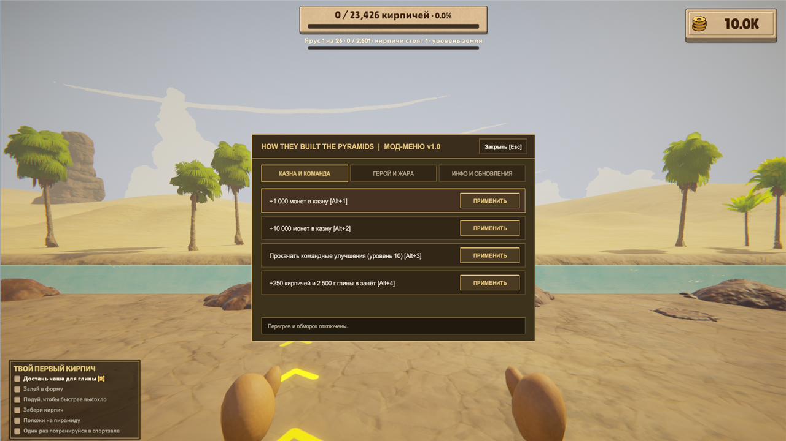

# How They Built the Pyramids - Мод-меню и таблица .CT

Лагерь 10 уровня со старта, запас монет, кирпичей и глины, быстрый бег, лёгкая переноска блоков и защита от жары + сохранение и `.CT` (`v1.0`, версия `0.43.0`, Windows и Steam Deck).

## Скачать
- **[Страница игры и все архивы на Boosty](https://boosty.to/cd_tixo/posts/41ca289e-3e82-4c0f-af84-9cad91e1b84a)**
- **[Архивы на GitHub Releases](https://github.com/neoru-droid/how-they-built-the-pyramids-mod-ru/releases)**
- **Новые релизы и заказ своей игры на [Boosty](https://boosty.to/cd_tixo):** подписка `120 ₽/мес` на все релизы или разовый пост `150 ₽`, своя игра в очередь - `350 ₽`, разбор вне очереди - `750 ₽`.
- **Обновления и новые релизы в Telegram:** [@neoru_droid](https://t.me/neoru_droid)

## Установка
1. **Windows:** закройте игру, распакуйте архив и запустите `HowTheyBuiltThePyramids-Trainer-Setup.exe` -> **«Установить мод-меню»** (в игре `F1` или `L3 + R3`).
2. **Steam Deck / Linux:** распакуйте архив и выполните `sh install-steamdeck.sh`.
3. **Удаление:** кнопка **«Удалить мод-меню»** в установщике (или `sh install-steamdeck.sh --uninstall`).

## Функции мод-меню

- **Казна и команда:** `Alt+1` `+1 000` монет, `Alt+2` `+10 000` монет, `Alt+3` командные улучшения 10 ур. (все 5 веток), `Alt+4` `+250` кирпичей и `2 500 г` глины.
- **Герой и жара:** `Alt+5` отключить перегрев и обморок, `Alt+6` быстрый бег `x1.9` и прыжок `x1.6`, `Alt+7` лёгкая переноска без замедления, `Alt+8` сбросить модификаторы.

## Таблица Cheat Engine и стартовое сохранение

- **Таблица (`HowTheyBuiltThePyramids-CheatTable-RU-v1.0.zip`):** те же 8 функций для процесса `Pyramid.exe` в Cheat Engine 7.5+.
- **Сохранение (`HowTheyBuiltThePyramids-CheatMod-v1.0.zip`):** готовый мир (`50 000` монет, улучшения 10 ур.) -> распаковать `Saves` в `%USERPROFILE%\AppData\LocalLow\PattezGames\How They Built the Pyramids`.

Нашли баг после патча - пишите в [Issues](https://github.com/neoru-droid/how-they-built-the-pyramids-mod-ru/issues).

[Сайт каталога](https://neoru-droid.github.io/) · [Каталог на Boosty](https://boosty.to/cd_tixo/posts/2a55d7e9-0f53-4d93-9f66-280981158dec) · [Telegram](https://t.me/neoru_droid) · [GitHub](https://github.com/neoru-droid) · [MIT](LICENSE) · Автор: `neoru-droid`
